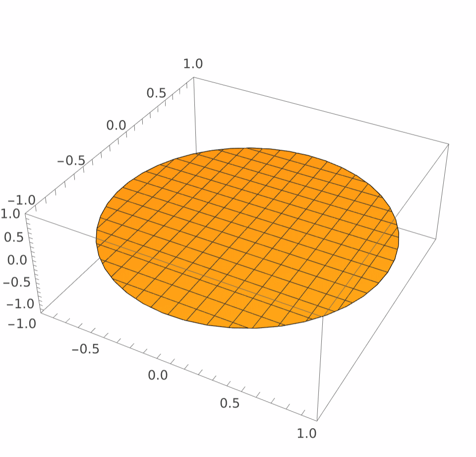

# Drum

Animated GIFs of modes of a vibrating circular drum, computed with Wolfram and driven from a small Python CLI.

<p align="center">
  
  
  
  <br>
  <sub>Modes (0, 1), (1, 2) and (2, 3)</sub>
</p>

## The physics

A drum is a circular, elastic membrane clamped at its edge. Its displacement $u$ obeys the wave equation:

$$\frac{\partial^2 u}{\partial t^2} = c^2 \nabla^2 u, \qquad u(R, \varphi, t) = 0 .$$

Separating variables in polar coordinates and solving the [Helmholtz equation](https://en.wikipedia.org/wiki/Helmholtz_equation#Vibrating_membrane) with apropriate boundary conditions gives the normal modes

$$u_{m,n}(r, \varphi, t) = A \, J_m\left(k_{m,n} \frac{r}{R}\right) \, \cos(m\varphi) \, \sin(\omega_{m,n} t), \qquad \omega_{m,n} = \frac{c\, k_{m,n}}{R},$$

where $J_m$ is the Bessel function of order $m$ and $k_{m,n}$ is the wave number, which must satisfy $k_{m,n} = j_{m,n}$ ($j_{m,n}$ is $n$-th root of $J_m$).

| Number | Meaning |
|---|---|
| $m = 0, 1, 2, \dots$ | number of angular nodes |
| $n = 1, 2, 3, \dots$ | number of radial nodes counting the clamped edge |

The program works in units where $R = c = 1$. Each GIF shows exactly one period $T = 2\pi / \omega_{m,n}$ and loops forever.

## Requirements

- Python 3.14+ and [uv](https://docs.astral.sh/uv/)
- A Wolfram installation with a licence (Mathematica, Wolfram Desktop or Wolfram Engine). The `WolframKernel` executable must be on your `PATH`.

## Installation

```bash
git clone git@github.com:Rafek731/drum.git
cd drum
uv sync
```

## Usage

```bash
uv run drum [OPTIONS]
```

Type the mode numbers `m n` at the prompt. Each GIF is saved as `mode_<m>_<n>.gif`.

```
Welcome to drum!
Setting up the kernels...
Provide mode numbers 'm n' or 'q' to quit
-> 1 3
Munching...
Done!
Saved /path/to/your/pwd/Pictures/mode_1_3.gif

Provide mode numbers 'm n' or 'q' to quit
-> q
```

Quit with `q`, `quit` or Ctrl+D. Starting the Wolfram kernels takes a few seconds, but it happens only once per run, so render as many modes as you like in one session :)

### Options

| Option | Default | Description |
|---|---|---|
| `-A`, `--amplitude` | `1.0` | Amplitude of the vibration. The plot's height is fixed at $\pm$ 1.1, so larger values get clipped. |
| `-m`, `--mesh` | `15` | Number of mesh lines drawn on the surface. |
| `-t`, `--total-frames` | `30` | Frames per period. More frames give a smoother animation but take longer to render. |
| `-f`, `--fps` | `30` | Frames per second of the GIF. |
| `-o`, `--output` | `./Pictures` | Directory for the GIFs. Created if it doesn't exist. |

**Example**: a smoother, slower animation with a denser mesh:

```bash
uv run drum -t 60 -f 20 -m 25 -o gifs
```

## How it works

```
src/drum/
├── __main__.py                 entry point: arguments -> prompt loop -> renderer
├── config.py                   RenderConfig and Mode (validated data)
├── renderer.py                 WolframRenderer: owns the Wolfram session
├── cli/
│   ├── args.py                 command-line options
│   └── interactive_prompt.py   reads and validates mode numbers
└── wolfram/
    └── drum.wl                 the physics and plotting (makeGif)
```

1. `WolframRenderer` starts one Wolfram kernel through [wolframclient](https://reference.wolfram.com/language/WolframClientForPython/) and loads `drum.wl`, which launches parallel subkernels.
2. For every mode you enter, Python calls `makeGif[m, n, path, opts]` in the kernel.
3. `makeGif` plots each frame with `Plot3D`, spreads the frames across the subkernels with `ParallelTable`, and exports the GIF.

## License

[MIT](LICENSE) © 2026 Rafał Mazur
